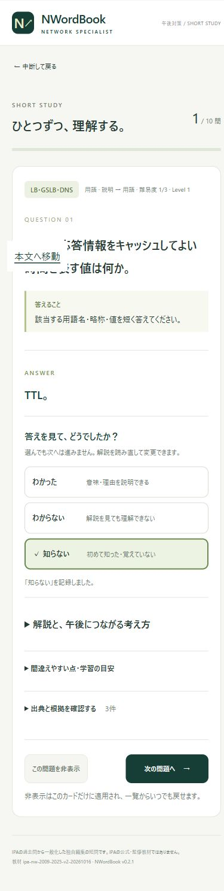

# GitHub Pages 初回公開

- 公開日：2026年10月17日（ユーザーの明示承認済み）
- 公開URL：https://0125hnaka.github.io/NWordBook/
- リポジトリ：0125hnaka/NWordBook（公開）
- 配信コミット：5789af4e4bfbc04cf3de429db1f3396249f3ee8d
- Actions：https://github.com/0125hnaka/NWordBook/actions/runs/39026320934
- build・deploy：ともに成功。教材検証・32件のテスト・ビルドを含む。

公開URLをブラウザーで開き、ホーム・学習開始・解答表示・「知らない」の記録・次の問題への移動を確認した。スマートフォン幅を設定した表示でも、ページ幅と表示領域幅が一致し、横方向のはみ出しがないことを確認した。実機スマートフォンでの確認はユーザーが行う。

確認画像：

理解度や設定は利用する端末・ブラウザー内に保存される。PCでの記録はスマートフォンへ自動同期されない。

今後も通常のpushは検証のみ。Webアプリの更新公開は、その都度承認後に手動ワークフローで行う。

2026年10月17日の追加指示により、今後の変更依頼はpush・Actions確認・既存Pagesへの更新公開まで継続承認されている。上記の都度承認方針はこの指示で更新された。
